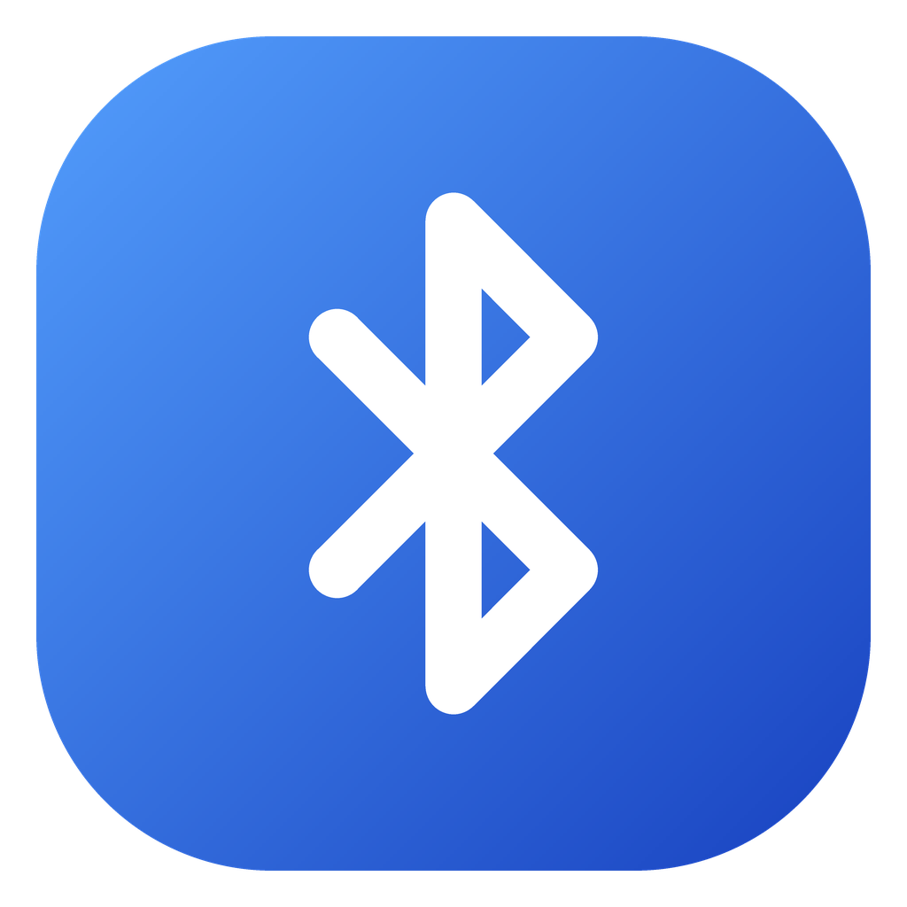
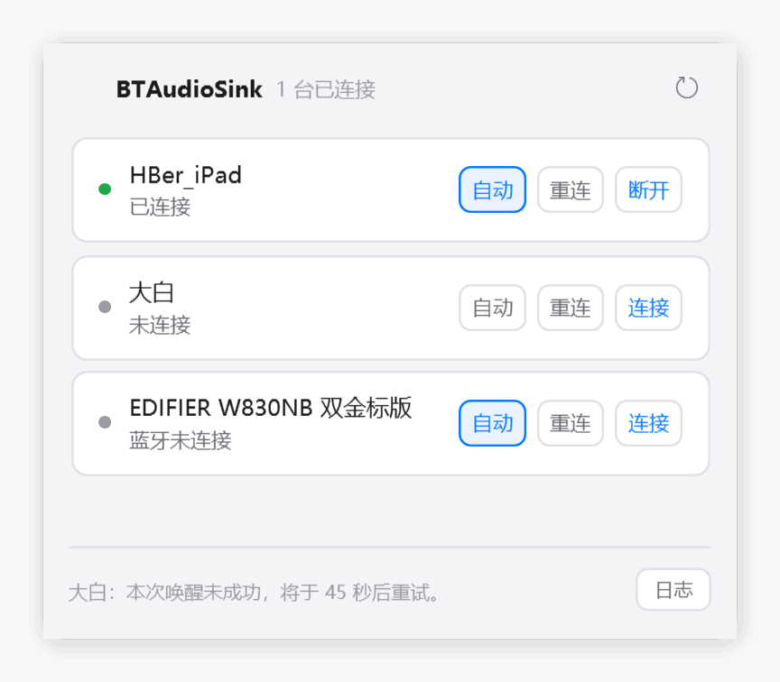
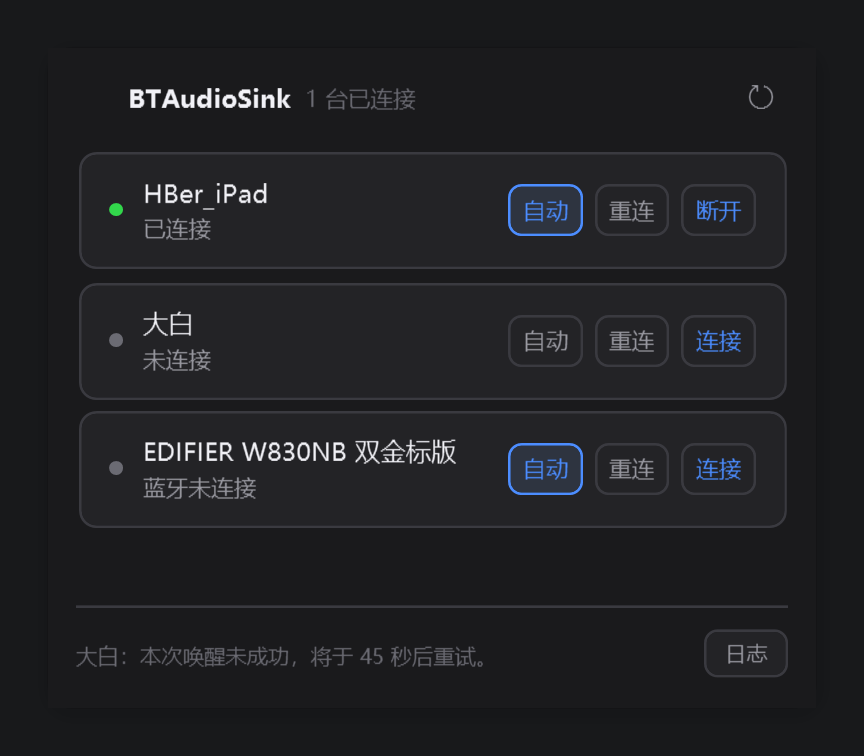

<p align="center">
  
</p>

<h1 align="center">BTAudioSink</h1>

<p align="center">
  <b>把 Windows 电脑变成蓝牙音箱</b><br>
  手机、平板、另一台电脑的音频，直接推到这台电脑上播放。支持多台设备同时连接。
</p>

<p align="center">
  <a href="https://github.com/lonelifox/BTAudioSink/releases/latest"></a>
  
  
  
</p>

<p align="center">
  
  
</p>

Windows 其实早就内置了这个能力（`AudioPlaybackConnection`，Win10 2004 起），只是系统设置里没有开关。这个程序就是那个开关——没有后台服务，不写驱动。

## 下载

**[→ 前往 Releases 下载最新版](https://github.com/lonelifox/BTAudioSink/releases/latest)**

| 文件 | 大小 | 适合 |
|---|---|---|
| `BTAudioSink-Setup-<版本>-x64.exe` | 约 54 MB | **推荐。** 双击安装，免管理员权限、不弹 UAC，控制面板可正常卸载 |
| `BTAudioSink-win-x64-standalone.zip` | 约 76 MB | 免安装，解压即用。适合放在 U 盘里带走 |

> **首次运行会弹「Windows 已保护你的电脑」？**
>
> 点「更多信息」→「仍要运行」。「更多信息」是「不运行」按钮下方的一行小字，不太显眼。
>
> 这个提示是 SmartScreen 对**没有代码签名**的程序的默认反应，不是病毒警告——它对新出现的程序
> 一律先拦，跟程序内容无关。不签名的原因很简单：OV 证书约 ¥500–800/年，而 2026 年起
> 连最贵的 EV 证书也不再免检，个人项目不值得为此付年费。
>
> 想自己验证这个包是安全的，有两个办法：源码和打包脚本都在仓库里，`dotnet build` 能复现出同样的程序；
> 每个 Release 附 `SHA256SUMS.txt`，和下载到的文件对比一下就知道有没有被改动过。
> 为什么不做代码签名：[docs/SIGNING.md](docs/SIGNING.md)。

## 功能

- **多设备同时连接** — 每台设备一条独立链路，声音在系统混音器里合并输出
- **Win11 原生外观** — 系统级圆角、Mica 毛玻璃、明暗主题跟随系统（Win10 自动降级为实色窗口）
- **中英双语** — 托盘右键菜单随时切换，立即生效并记住选择
- **逐台自动重连** — 每台设备独立开关，开了的断开后自动连回，没开的绝不动；你手动断开的不会被拽回来
- **托盘常驻** — 左键点图标开合面板（跟着任务栏位置贴边滑出，带回弹），右键出设置菜单
- **高 DPI 适配** — PerMonitorV2，换显示器不糊；窗口高度固定，设备多了列表自己滚动
- **运行日志** — 底栏「日志」按钮直接打开 `%APPDATA%\BTAudioSink\log.txt`

## 系统要求

| 项目 | 要求 |
|---|---|
| 操作系统 | Windows 10 2004（build 19041）或更高 |
| 运行时 | 不需要。安装包和绿色包都自带 .NET 运行时 |
| 蓝牙适配器 | 需支持 A2DP Sink 角色（绝大多数内置和 USB 适配器都支持） |

圆角与 Mica 需要 Windows 11；Win10 上会自动降级为直角实色窗口，功能不受影响。

## 使用

1. 先在系统设置里把手机和电脑**配对**（程序只能看到已配对的设备，不负责配对）
2. 左键点托盘图标打开面板
3. 点设备右侧的「连接」
4. 手机上播放音频

面板里每台设备一行，右侧依次是「自动」开关、「重连」、「连接 / 断开」。点设备行可展开蓝牙详情（地址、链路状态、信号强度、设备类型）。

外观、毛玻璃、开机自启、语言、全部断开都在**右键菜单**里。没有关闭按钮——点面板外面就是收起，真正退出用右键菜单的「退出」。

## 常见问题

**列表是空的？**
确认蓝牙已打开、设备已配对。这个接口只枚举已配对的设备。

**提示 `RequestTimedOut`？**
手机端没响应。解锁手机，在蓝牙设置里点一下本机。

**连上了但没有声音？**
检查系统「音量合成器」里对应设备的音量，以及手机是否真的在播放媒体音频。

**能当麦克风用吗？**
不能。A2DP 是单向的媒体音频传输，只负责把声音送进电脑。

**多台设备同时连接会互相干扰吗？**
不会。各自独立的蓝牙链路，进系统后混合成一路输出。代价是混音器里分不清哪一声来自哪台设备。

**卸载后自启项还在吗？**
不会。卸载器会清掉 HKCU 的 Run 键。绿色版是手动删除的，记得顺手去
`HKCU\Software\Microsoft\Windows\CurrentVersion\Run` 把 `BTAudioSink` 那一项删掉。

## 从源码构建

需要 .NET 9 SDK。

```bash
git clone https://github.com/lonelifox/BTAudioSink.git
cd BTAudioSink
dotnet build
dotnet run
```

打包安装器、离屏预览工程、体检脚本、CI 流程这些，见 **[docs/DEVELOPMENT.md](docs/DEVELOPMENT.md)**。

## 已知限制

- 只能接收音频，不能当麦克风
- 部分老蓝牙适配器不支持 Sink 角色，`TryCreateFromId` 会返回 null
- 手机端有时需要手动确认连接
- 设备必须先在系统设置里完成配对，程序不做配对
- 断一台设备时，系统可能把同一适配器上的其它设备一起报成断开，程序会自动恢复
- Mica 在极少数显卡驱动上可能不渲染，程序会在异常退出后自动关闭它

## 许可

[MIT](LICENSE)
