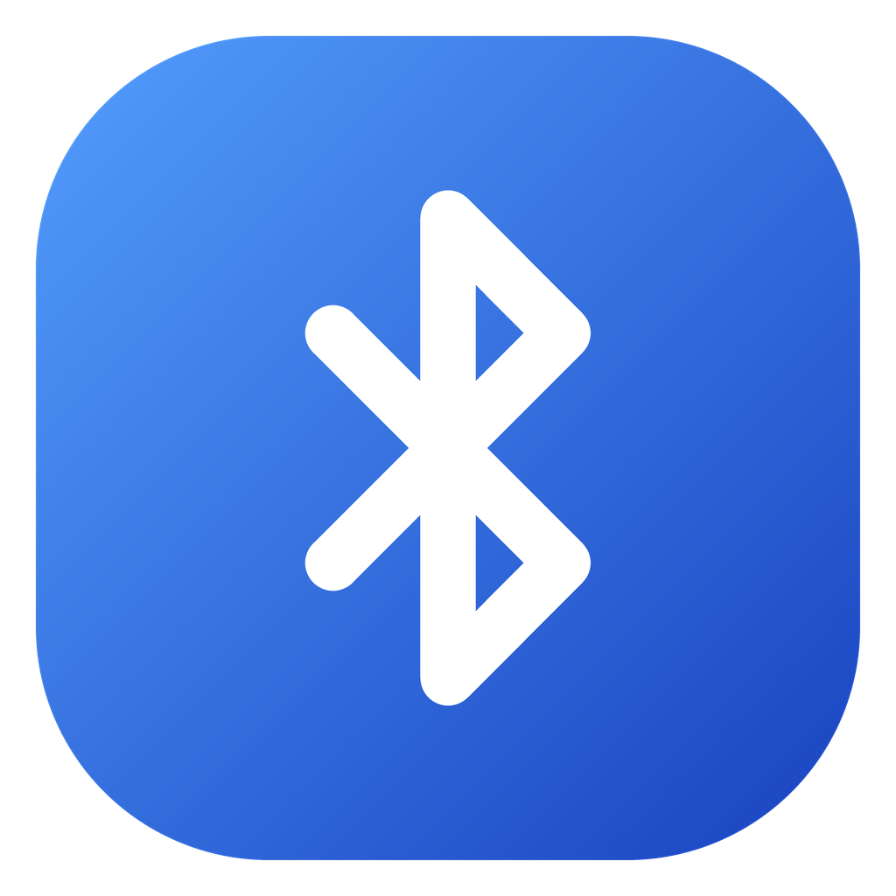
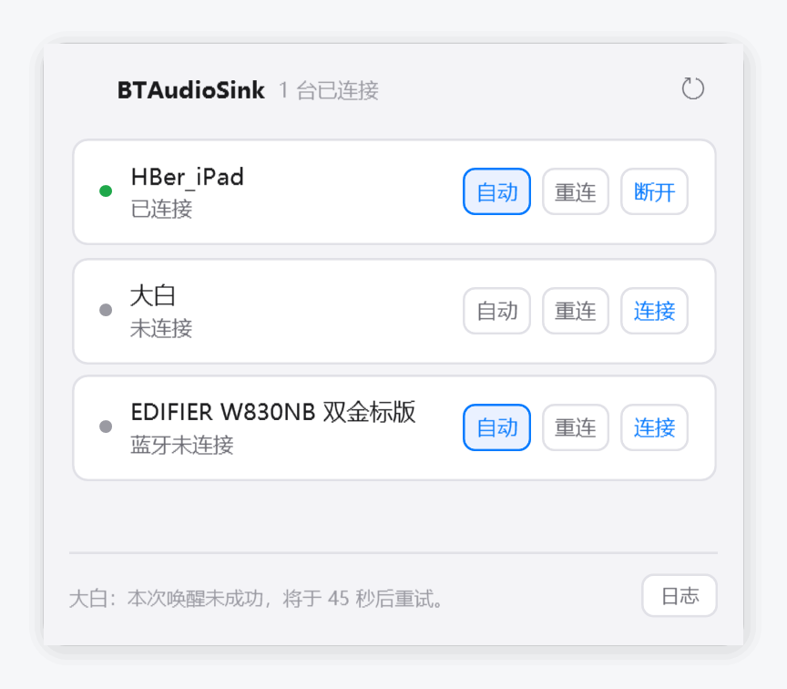
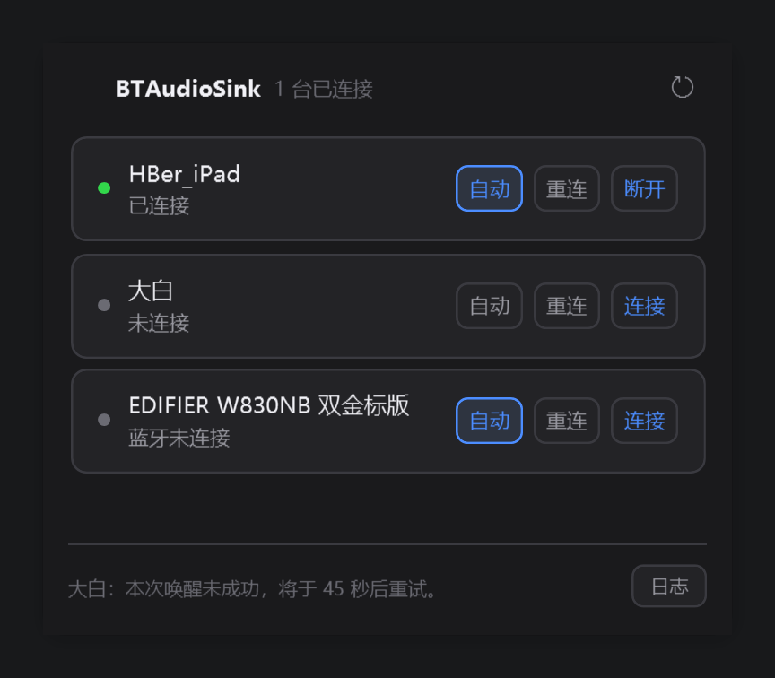

<p align="right"><b>English</b> | <a href="README.md">简体中文</a></p>

<p align="center">
  
</p>

<h1 align="center">BTAudioSink</h1>

<p align="center">
  <b>Turn your Windows PC into a Bluetooth speaker</b><br>
  Stream audio from your phone, tablet or another PC straight to this machine. Multiple devices can be connected at the same time.
</p>

<p align="center">
  <a href="https://github.com/lonelifox/BTAudioSink/releases/latest"></a>
  
  
  
</p>

<p align="center">
  
  
</p>

Windows has been able to do this since build 2004 — the API is `AudioPlaybackConnection` — but Settings never exposed a switch for it. This app is that switch. No background service, no driver.

> The UI is bilingual (Chinese/English) and switches in the tray menu. The source comments and developer docs are in Chinese.

## Download

**[→ Get the latest release](https://github.com/lonelifox/BTAudioSink/releases/latest)**

| File | Size | For |
|---|---|---|
| `BTAudioSink-Setup-<version>-x64.exe` | ~54 MB | **Recommended.** Double-click to install. Per-user, no admin rights, no UAC prompt, uninstalls cleanly from Settings |
| `BTAudioSink-win-x64-standalone.zip` | ~76 MB | Portable. Unzip and run. Handy on a USB stick |

> **"Windows protected your PC" on first run?**
>
> Click **More info → Run anyway**. "More info" is the small text right below the "Don't run" button.
>
> That prompt is SmartScreen's default reaction to any **unsigned** binary — it is not a virus warning, and it has nothing to do with what the program does. The reason there is no signature: an OV certificate costs roughly $70–110 per year, and since 2026 even the most expensive EV certificates no longer skip the warning, so it is not worth an annual fee for a personal project.
>
> To verify the download yourself: the source and the packaging scripts are both in this repo, so `dotnet build` reproduces the same binary, and every release ships a `SHA256SUMS.txt` you can compare against. Why we skipped signing (in Chinese): [docs/SIGNING.md](docs/SIGNING.md).

## Features

- **Multiple devices at once** — each device gets its own link; audio is mixed by the Windows mixer
- **Native Windows 11 look** — system rounded corners, Mica backdrop, light/dark follows the OS (falls back to a solid window on Windows 10)
- **Bilingual UI** — switch between Chinese and English from the tray menu, applied instantly and remembered
- **Per-device auto reconnect** — toggle per device; enabled devices reconnect after a drop, disabled ones are left alone, and anything you disconnected by hand stays disconnected
- **Lives in the tray** — left-click toggles the panel (it slides out along the taskbar edge with a slight overshoot), right-click opens the settings menu
- **High DPI aware** — PerMonitorV2, stays crisp across monitors; fixed window height, the list scrolls when you have many devices
- **Log file** — the "Log" button in the footer opens `%APPDATA%\BTAudioSink\log.txt`

## Requirements

| Item | Requirement |
|---|---|
| OS | Windows 10 version 2004 (build 19041) or later |
| Runtime | None. Both the installer and the portable zip bundle the .NET runtime |
| Bluetooth adapter | Must support the A2DP Sink role (true for almost every built-in and USB adapter) |

Rounded corners and Mica require Windows 11; on Windows 10 the window degrades to square and solid, everything else works the same.

## Usage

1. **Pair** your phone with the PC in Windows Settings first — the app only lists paired devices, it does not pair for you
2. Left-click the tray icon to open the panel
3. Click **Connect** on the device row
4. Start playing audio on the phone

Each device is one row, with **Auto**, **Reconnect** and **Connect / Disconnect** on the right. Click the row to expand Bluetooth details (address, link state, signal strength, device class).

Appearance, Mica, run-at-login, language and "disconnect all" live in the **right-click menu**. There is no close button — clicking outside the panel just hides it, and the tray menu's **Exit** is the real quit.

## FAQ

**The list is empty.** Make sure Bluetooth is on and the device is paired; the underlying API only enumerates paired devices.

**It says `RequestTimedOut`.** The phone did not respond. Unlock it and tap this PC in its Bluetooth settings.

**Connected but no sound.** Check the per-device volume in the Windows volume mixer, and make sure the phone is actually playing media audio. Clicking **Reconnect** is also worth a try.

**Can it work as a microphone?** No. A2DP is one-way media streaming into the PC.

**Do multiple devices interfere with each other?** No. Each has its own Bluetooth link and they are mixed into one output. The trade-off is that the mixer cannot tell you which sound came from which device.

**Does uninstalling leave the autostart entry behind?** No, the uninstaller removes the HKCU Run value. The portable build has to be deleted by hand — remember to remove the `BTAudioSink` value under `HKCU\Software\Microsoft\Windows\CurrentVersion\Run` too.

## Build from source

Requires the .NET 9 SDK.

```bash
git clone https://github.com/lonelifox/BTAudioSink.git
cd BTAudioSink
dotnet build
dotnet run
```

Installer packaging, the offscreen preview project, the consistency check scripts and CI are documented in **[docs/DEVELOPMENT.md](docs/DEVELOPMENT.md)** (Chinese).

## Known limitations

- Audio in only, never a microphone
- Some older Bluetooth adapters lack the Sink role; `TryCreateFromId` returns null on those
- Devices must be paired in Windows Settings first; the app does not pair
- Disconnecting one device can make Windows report its neighbours on the same adapter as disconnected too; the app recovers automatically
- Mica may fail to render on a few GPU drivers; the app turns it off automatically after an abnormal exit

## License

[MIT](LICENSE)
